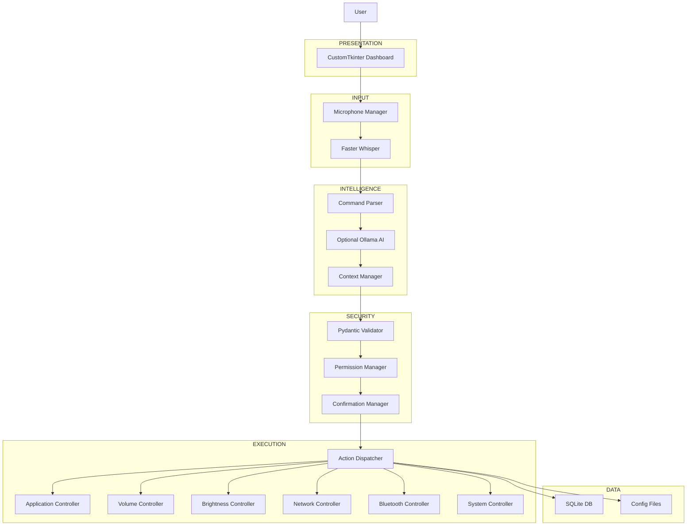

# SYSTEM DESIGN DOCUMENT (SDD)
# AURA – AI Desktop Assistant

**Document Version:** 1.0  
**Date:** November 10, 2026  
**Status:** Proposed – Technical Design Baseline  
**Reference PRD:** AURA PRD v2.0  
**Reference SRS:** AURA SRS v1.0  

**Technology:** Python 3.11+  
**Platform:** Windows 11 (64-bit)  
**Architecture:** Modular Layered Architecture  
**Application Type:** Desktop Application  

---

> [!IMPORTANT]
> **Active Security Constraints (Mandated Policy):**
> 1. **No System Shutdown or Restart:** The assistant shall never have the ability to shut down, restart, hibernate, or power down the host machine. Any such request must be deterministically rejected.
> 2. **Zero Access to Personal Files:** The assistant must not read, write, modify, or list any user personal directories (Documents, Downloads, Pictures, Desktop, etc.). Interaction is limited to a predefined whitelist of applications and internal configuration storage.

# 1. INTRODUCTION

## 1.1 Purpose
This System Design Document describes the internal architecture, components, modules, interfaces, data structures, execution workflows, security mechanisms, and implementation strategy of AURA. It translates the requirements defined in the PRD and SRS into a practical engineering design.

## 1.2 System Overview
AURA is a voice-controlled AI desktop assistant that performs predefined laptop operations using natural language commands.

The application will use a modular architecture in which each component performs a specific responsibility. The AI layer will understand commands, while a separate deterministic execution layer will control the laptop.

The application will never provide unrestricted access to the operating system to an AI model.

## 1.3 Design Objectives
1. Build a modular and maintainable application.
2. Separate voice processing from system execution.
3. Keep AI interpretation independent of operating-system operations.
4. Enforce permissions before every action.
5. Support offline execution of basic commands.
6. Minimize resource consumption.
7. Provide clear communication between modules.
8. Make future feature additions straightforward.

---

# 2. SYSTEM ARCHITECTURE

## 2.1 Architecture Pattern
AURA will use a **Modular Layered Architecture**.

The system will be divided into six primary layers.

| Layer | Responsibility |
|---|---|
| Presentation Layer | Desktop interface and user interaction |
| Input Processing Layer | Microphone and speech recognition |
| Intelligence Layer | Command parsing and AI understanding |
| Security Layer | Permissions, validation and confirmation |
| Execution Layer | Laptop operations and Windows integration |
| Data Layer | Configuration, history and persistence |

Each layer will communicate through defined interfaces rather than directly accessing unrelated components.

## 2.2 High-Level Architecture Diagram


---

# 3. COMPONENT DESIGN

## 3.1 Voice Input
- `voice/microphone_manager.py` – Handles device enumeration, gain control, and VAD.
- `voice/speech_recognition.py` – Wraps Faster‑Whisper, provides async `prewarm` and `transcribe`.

## 3.2 Intelligence
- `intelligence/parser.py` – Deterministic intent mapping for core commands.
- `intelligence/ai_bridge.py` – Optional LLM (Ollama) fallback for ambiguous phrasing.
- `intelligence/context.py` – Maintains short‑term conversation context for follow‑ups.

## 3.3 Security
- `security/permission_manager.py` – Loads `authorized_actions.json`, validates intent, enforces the two mandatory constraints.
- `security/validator.py` – Pydantic models for each action schema.
- `security/confirm_manager.py` – Handles explicit user confirmations for sensitive actions (e.g., modifying system volume beyond a threshold).

## 3.4 Execution Layer
- `execution/dispatcher.py` – Routes verified actions to concrete controller classes.
- Controllers (`controllers/app_controller.py`, `controllers/volume_controller.py`, `controllers/brightness_controller.py`, `controllers/network_controller.py`, `controllers/system_controller.py`).
- All controllers interact only with whitelisted Windows APIs or third‑party packages (pycaw, screen‑brightness‑control, pywin32).

## 3.5 Data Layer
- `data/config.py` – Loads `.env`/`settings.json`.
- `data/database.py` – Simple SQLite wrapper for command history and user preferences.

---

# 4. SECURITY ARCHITECTURE

- **Action Registry:** Defined in `authorized_actions.json`. Contains only safe actions (volume, brightness, app launch, Wi‑Fi/Bluetooth toggle, lock screen, screenshot). No shutdown/restart actions.
- **Permission Enforcement:** Every request passes through `PermissionManager.check(intent)`; if intent is disallowed, a `PermissionDeniedError` is raised and a spoken response “I am not authorized …” is generated.
- **File System Isolation:** The only writable path is the application directory (`AURA/`) and its internal SQLite DB. All file‑system APIs are wrapped to raise if paths escape this sandbox.

---

# 5. DATA DESIGN

## 5.1 SQLite Schema (`aura.db`)
```sql
CREATE TABLE IF NOT EXISTS command_log (
    id INTEGER PRIMARY KEY AUTOINCREMENT,
    timestamp DATETIME DEFAULT CURRENT_TIMESTAMP,
    raw_text TEXT NOT NULL,
    intent TEXT,
    status TEXT CHECK(status IN ('SUCCESS','FAILURE')),
    details TEXT
);
```

## 5.2 Configuration Files
- `settings.json` – UI preferences, hotkey configuration, model selection.
- `app_aliases.json` – Mapping of friendly names to executable paths (whitelisted).
- `authorized_actions.json` – JSON schema defining allowed intents, required parameters, and optional confirmation thresholds.

---

# 6. ERROR HANDLING & LOGGING
- Central `logger` using `logging` module, configurable via `AURA_LOG_LEVEL`.
- All exceptions are caught at the top‑level `Assistant.run()` loop; user receives a friendly TTS error message, and details are persisted to the DB.

---

# 7. TESTING STRATEGY
- Unit tests for each controller (`tests/unit/`).
- Integration tests exercising the full pipeline with mocked Windows APIs (`pytest-mock`).
- End‑to‑end UI tests using `pyautogui` to simulate button clicks (running in CI on Windows).

---

# 8. DEPLOYMENT & PACKAGING
- `requirements.txt` lists all third‑party libraries.
- `install_aura.bat` creates a virtual environment, installs dependencies, and creates a desktop shortcut.
- Application can be started via `run_aura.bat` which activates the venv and runs `python main.py`.

---

# 9. FUTURE EXTENSIONS
- Wake‑word activation (e.g., Snowboy or Porcupine).
- Multi‑language support (Hindi, Hinglish).
- Cross‑platform adapters (Linux, macOS) respecting the same security model.
- User‑defined macros (stored in `authorized_actions.json`).

---

# 10. CONCLUSION
The design presented satisfies all functional requirements while enforcing strict security boundaries: no power‑off capabilities and zero personal‑file access. The modular layered architecture enables incremental development, easy testing, and future extensions without compromising the core security guarantees.
