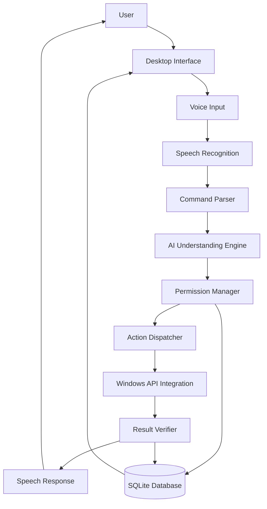

# SOFTWARE REQUIREMENTS SPECIFICATION (SRS)
# AURA – AI Desktop Assistant

**Document Version:** 1.0 (with Security Amendment v2)  
**Date:** November 10, 2026  
**Document Status:** Approved – Development Baseline  
**Product:** AURA – AI Desktop Assistant  
**Target Platform:** Windows 11 (64-bit)  
**Programming Language:** Python 3.11+  
**Reference Document:** AURA PRD v2.0  

> [!IMPORTANT]
> **Active Security Constraints (Mandated Policy):**
> 1. **No System Shutdown or Restart:** `shutdown_system` and `restart_system` are strictly eliminated from the action registry, schema, and dispatcher. Any voice command requesting power-off, reboot, or shutdown is deterministically rejected.
> 2. **Zero Access to Personal Files:** AURA has zero tools, APIs, or permissions to search, browse, read, or modify user personal files (`Documents`, `Downloads`, `Pictures`, `Desktop`, credentials, browser history). Application management is strictly restricted to pre-registered application aliases.

---

# 1. INTRODUCTION

## 1.1 Purpose
This Software Requirements Specification defines the technical and functional requirements for developing AURA, a voice-controlled AI desktop assistant.

The purpose of this document is to establish a clear understanding of the software's expected behavior, architecture boundaries, module responsibilities, interfaces, data handling, security requirements, and testing criteria.

This document serves as the primary technical reference during implementation and testing.

## 1.2 Scope
AURA is a Python-based desktop application that enables users to control supported laptop operations through natural language voice commands.

The application will:
1. Capture voice instructions.
2. Convert speech into text.
3. Interpret the requested operation.
4. Generate a structured action request.
5. Validate the requested operation.
6. Check user permissions.
7. Execute the authorized Python function.
8. Verify the resulting system state.
9. Generate a voice response.
10. Record the execution result.

AURA initially supports Windows 11 (64-bit).

## 1.3 Product Objectives
- Provide reliable voice-based laptop control.
- Reduce manual interaction with the operating system.
- Support natural language command interpretation.
- Execute predefined operations securely.
- Provide offline support for common commands.
- Maintain low resource consumption.
- Provide an understandable desktop interface.
- Keep the user in control of system permissions.

## 1.4 Definitions and Abbreviations
| Term | Meaning |
|---|---|
| AURA | AI Desktop Assistant |
| AI | Artificial Intelligence |
| LLM | Large Language Model |
| STT | Speech-to-Text |
| TTS | Text-to-Speech |
| UI | User Interface |
| API | Application Programming Interface |
| OS | Operating System |
| MVP | Minimum Viable Product |
| JSON | JavaScript Object Notation |
| SQLite | Lightweight relational database |
| UAC | User Account Control |
| Intent | The operation requested by the user |
| Dispatcher | Component that routes approved actions |
| Permission Registry | Configuration defining authorized operations |

---

# 2. GENERAL DESCRIPTION

## 2.1 Product Perspective
AURA is a standalone desktop application operating within the Windows environment. It communicates with Windows through controlled APIs and predefined Python functions. It does not require unrestricted administrator privileges or unrestricted filesystem access.

## 2.2 Product Functions
| Module | Responsibility |
|---|---|
| Voice Input | Capture user voice |
| Speech Recognition | Convert audio into text |
| Command Parser | Interpret simple instructions |
| AI Engine | Understand flexible natural language |
| Permission Manager | Validate user authorization |
| Action Dispatcher | Execute authorized functions |
| Application Controller | Manage supported applications (whitelist only) |
| Volume Controller | Control system volume |
| Brightness Controller | Control display brightness |
| Connectivity Controller | Manage Wi-Fi and Bluetooth |
| System Controller | Perform approved system operations (lock, battery, screenshot) |
| Result Verifier | Verify operation outcomes |
| Speech Response | Generate spoken responses |
| Dashboard | Provide user interaction |
| Logger | Maintain execution history |

## 2.3 Operating Environment
| Component | Specification |
|---|---|
| Operating System | Windows 11 64-bit |
| Programming Environment | Python 3.11+ |
| Desktop Framework | CustomTkinter |
| Database | SQLite |
| Microphone | Built-in or external |
| Audio Output | Laptop speakers or headphones |
| Internet | Optional for basic functionality |
| AI Backend | Local or optional cloud |
| Architecture | Modular Python application |

## 2.4 Design Constraints
1. The initial release targets Windows 11.
2. The application must use predefined system operations.
3. AI-generated instructions must not be directly executed.
4. The application must use minimum required privileges.
5. Basic laptop operations must work without an internet connection.
6. Operating-system integrations must be isolated from the AI layer.
7. **Strict Security Exclusion:** No shutdown/restart functions; zero personal file access.

---

# 3. SOFTWARE ARCHITECTURE REQUIREMENTS

## 3.1 High-Level Architecture

---

# 4. DETAILED SOFTWARE FUNCTIONAL REQUIREMENTS

## 4.1 Voice Input Module (MOD-001)
- **SRS-VI-001:** Initialize selected microphone device. (P0)
- **SRS-VI-002:** Capture audio when push-to-talk is activated. (P0)
- **SRS-VI-003:** Stop recording upon release or listening cancellation. (P0)
- **SRS-VI-004:** Forward captured audio buffer to STT. (P0)
- **SRS-VI-005:** Handle unavailable microphone gracefully. (P0)
- **SRS-VI-006:** Release audio resources after capture. (P0)
- **SRS-VI-007:** Expose real-time microphone status to UI. (P0)
- **SRS-VI-008:** Keyboard shortcut for microphone activation. (P1)

## 4.2 Speech Recognition Module (MOD-002)
- **SRS-STT-001:** Accept audio buffer from Voice Input module. (P0)
- **SRS-STT-002:** Convert speech audio to text via Faster-Whisper. (P0)
- **SRS-STT-003:** Return transcription to Command Parser. (P0)
- **SRS-STT-004:** Identify empty or inaudible input and prompt for repetition. (P0)
- **SRS-STT-005:** No persistent storage of audio recordings by default. (P0)

## 4.3 Command Parser Module (MOD-003)
- **SRS-CP-001:** Accept transcription string. (P0)
- **SRS-CP-002:** Match deterministic regex patterns for volume, brightness, whitelisted apps, Wi-Fi, Bluetooth, battery, lock, screenshot. (P0)
- **SRS-CP-003:** Extract parameters into validated Pydantic structures. (P0)
- **SRS-CP-004:** Intercept and refuse any command relating to shutdown or restart. (P0)
- **SRS-CP-005:** Intercept and refuse any command attempting to access personal files. (P0)
- **SRS-CP-006:** Route ambiguous commands to the optional AI engine. (P1)

## 4.4 AI Understanding Module (MOD-004)
- **SRS-AI-001:** Accept transcription for non-deterministic intent parsing. (P1)
- **SRS-AI-002:** Output strictly validated structured JSON conforming to intent schema. (P1)
- **SRS-AI-003:** Forbidden from generating code, shell commands, or direct API calls. (P0)
- **SRS-AI-004:** Forbidden from accessing personal files or filesystem browsing tools. (P0)

## 4.5 Permission Manager (MOD-005)
- **SRS-PM-001:** Maintain an authorized action registry in SQLite. (P0)
- **SRS-PM-002:** Check requested intent against registry and user settings. (P0)
- **SRS-PM-003:** Immediately block unauthorized or disabled capabilities. (P0)
- **SRS-PM-004:** Reject unknown or malformed action requests. (P0)

## 4.6 Action Dispatcher (MOD-006)
- **SRS-AD-001:** Accept only validated, authorized requests from Permission Manager. (P0)
- **SRS-AD-002:** Route to strictly predefined Python functions (no dynamic `eval` or shell injection). (P0)
- **SRS-AD-003:** Capture execution results and report exceptions safely. (P0)

---

# 5. SYSTEM CONTROL MODULES

## 5.1 Application Controller (MOD-007)
- **SRS-APP-001:** Launch applications solely from approved whitelist alias registry. (P0)
- **SRS-APP-002:** Verify process startup. (P0)
- **SRS-APP-003:** Support graceful application closing via `WM_CLOSE`. (P0)
- **SRS-APP-004:** Never force-terminate or access user files during launch/close. (P0)

## 5.2 Volume Controller (MOD-008)
- **SRS-VOL-001:** Retrieve current master volume level via `pycaw`. (P0)
- **SRS-VOL-002:** Set master volume percentage ($0-100$). (P0)
- **SRS-VOL-003:** Relative volume increase/decrease. (P0)
- **SRS-VOL-004:** Mute/unmute master audio. (P0)
- **SRS-VOL-005:** Verify post-execution audio level. (P0)

## 5.3 Brightness Controller (MOD-009)
- **SRS-BR-001:** Retrieve display brightness via `screen-brightness-control`. (P0)
- **SRS-BR-002:** Set brightness percentage ($0-100$). (P0)
- **SRS-BR-003:** Relative brightness adjustment. (P0)
- **SRS-BR-004:** Verify post-execution brightness level and handle unsupported hardware. (P0)

## 5.4 Connectivity Controller (MOD-010)
- **SRS-CON-001:** Retrieve Wi-Fi adapter status and toggle state where supported. (P1)
- **SRS-CON-002:** Retrieve Bluetooth radio status and toggle state where supported. (P1)
- **SRS-CON-003:** Verify resulting states via Windows network interfaces. (P1)

## 5.5 System Controller (MOD-011)
- **SRS-SYS-001:** Lock workstation via Win32 `LockWorkStation()`. (P1)
- **SRS-SYS-002:** Retrieve battery percentage and power state via `psutil`. (P1)
- **SRS-SYS-003:** Capture screenshot to clipboard or dedicated app screenshot directory. (P1)
- **SRS-SYS-004 (SECURITY ENFORCEMENT):** Shutdown and restart operations are permanently disabled.

---

# 6. RESULT VERIFICATION & FEEDBACK

## 6.1 Result Verification (MOD-012)
- Query actual system state after execution and compare with target state.
- Return structured status (`success`, `intent`, `requested_value`, `actual_value`, `message`).
- Never claim success without verification.

## 6.2 Text-to-Speech (MOD-013)
- Render verified result as verbal speech via `pyttsx3`.
- Clear, polite, non-repetitive responses.

## 6.3 Desktop Interface & Storage (MOD-014 & MOD-015)
- CustomTkinter UI: PTT button, status indicator, recognized text, response display, history log, permission toggles.
- SQLite: `execution_logs`, `app_aliases`, `user_permissions`, `user_settings`.
